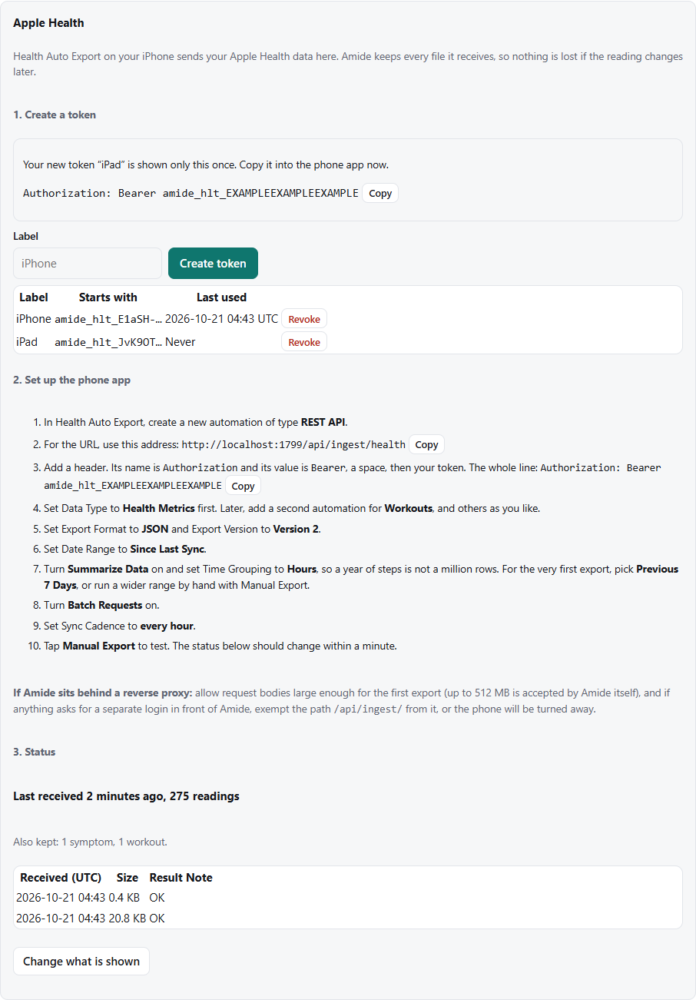
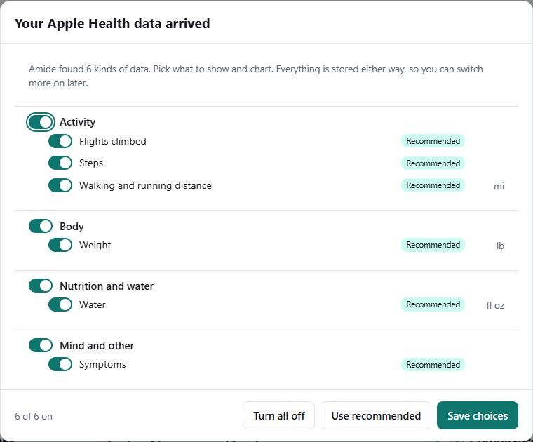
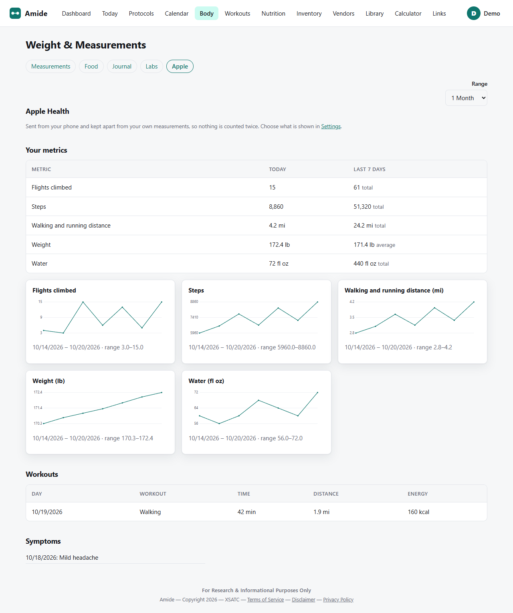

# Amide: the complete guide

Amide is a self-hosted tracker for peptides and everything around them: what you own, what you ordered, what you take, how your body responds. It runs on your own computer and your data never leaves it unless you turn on one of a few optional connections (listed at the end).

> **Amide is a record-keeping tool. Nothing in it is medical advice.** The examples, cautions and calculators are prompts to ask a prescriber or pharmacist, not instructions.

**About the pictures.** Every screenshot here was taken from a throwaway demo account with invented data: a made-up person named "Demo", an invented vendor called "Acme Labs", and made-up weigh-ins, orders and prices. Nothing in them is a real person, vendor or price.

**Contents**

1. [Getting started](#1-getting-started)
2. [The Dashboard](#2-the-dashboard)
3. [Inventory and orders](#3-inventory-and-orders)
4. [Vendors and price lists](#4-vendors-and-price-lists)
5. [Protocols](#5-protocols)
6. [Today and the Calendar](#6-today-and-the-calendar)
7. [The Calculator](#7-the-calculator)
8. [Body: weight, journal, labs and photos](#8-body-weight-journal-labs-and-photos)
    - [Apple Health](#8a-apple-health)
9. [Nutrition](#9-nutrition)
10. [Workouts and the Fitness Test](#10-workouts-and-the-fitness-test)
11. [The Library](#11-the-library)
12. [Settings](#12-settings)
    - [Learn](#12a-learn), [Links](#12b-links)
13. [Backup, restore and your privacy](#13-backup-restore-and-your-privacy)
14. [Quick answers](#14-quick-answers)

---

## 1. Getting started

### Open Amide and accept the notice

Open Amide in a browser (by default `http://localhost:1707`). The first page is a legal notice. Tick **I understand the safety statement above** and press **Okay**. You only do this once per browser sign-in.

### Create your account or sign in

The first account you create is the **administrator**: it can add other people, reset their passwords and remove them. Everyone else gets their own private account. Passwords must be at least 8 characters (your administrator can change that rule).

### First steps, in this order

1. **Settings** (your name, top right). Set your **time zone**, fill in the **body profile** (sex, birth date, height, activity level) so the Food and Energy pages can work, and turn on **two-factor sign-in** or add a **passkey** if you like (a passkey signs you in with Face ID or a fingerprint, with no password or code).
2. Add what you own in **Inventory** ([section 3](#3-inventory-and-orders)).
3. Build a protocol in **Protocols** ([section 5](#5-protocols)).
4. Each day, open **Today** and press **Log** as you take each dose.

### The top menu

Dashboard · Today · Protocols · Calendar · Body · Workouts · Nutrition · Inventory · Vendors · Library · Calculator. **Links** keeps your saved sites (see [section 12b](#12b-links)). Your name, top right, opens Settings, Backup and sign out.

### Install it like an app

On a phone or computer, use the browser's menu (**Install** or **Add to Home Screen**). It needs `localhost` or HTTPS. See [DEPLOYING.md](DEPLOYING.md).

---

## 2. The Dashboard

The Dashboard pulls the day together on one page.

| Card | What it shows |
|---|---|
| **Today's Schedule** | Doses due today, in time-of-day order, with a **Due** badge. |
| **Workouts This Week** | A Monday-to-Sunday strip (done, missed, upcoming, rest), a progress bar and what is next. |
| **Body** | Your latest tape measurements on a body diagram. Green means moving the way you want (smaller waist and hips, bigger limbs). Click a dot for the previous value. |
| **Alerts** | Expiring items, low stock, late shipments, vials that will run out soon, new price lists, and a **BODY PHOTO** line when it is time for another photo (see [section 8](#8-body-weight-journal-labs-and-photos)). |
| **Compliance** | Bars for Protocol, water (H2O), Diet and Workout over the window you pick from the drop-down. |
| **Water Goal** | Your daily goal (from your weight), what you have logged, and **+ Log water**. The fill is blue below half the day's goal, yellow from half, and green from 90%, the same 90% the water compliance bar counts as a good day. |
| **Cost Snapshot** | What your active protocols cost. |
| **Journal** | A quick note box. |
| **Weight** | A chart with value lines. Each day's point is labeled with what you lost (green, −) or gained (amber, +) since the day before. Several weigh-ins on one day count once, by the last one. |
| **Items In Shipment** | Orders on the way, with the vendor in a yellow tab on the left, tracking, and a **Check in** button for when they arrive. |
| **Apple Health** | Your own dashboard only. Before setup it offers the setup steps; once data flows it shows when data last arrived and today's steps and walking distance (the ones you switched on), with links to the Apple tab and Settings. |

If someone shares their data with you (Settings, Sharing) you can view their Dashboard from the menu that appears.

---

## 3. Inventory and orders

### The inventory list

- **Add item** records a peptide, BAC water or a supply (syringes, alcohol pads and so on). Tick **Local seller** for something you pick up in person: it will not raise a late-shipment alert.
- The peptide list is in **use-first order**: what expires soonest, then what arrived earliest. Empty shelves go last. Switch to alphabetical with the sort box.
- **Runs out** tells you when an item will be gone at your current doses, and the Dashboard warns you ahead of time.
- **Ordering supplies.** Press **New order** and choose **Supply** on a line: a new supply (pick what kind it is, so Amide knows what a shot or a reconstitution uses) or a restock of one you already track. When the order arrives, **Check in** it: the received quantity is added to the supply's count.
- **What each action uses up.** Amide takes these from your supplies for you (each is a supply item of that type):
  - Reconstituting a vial: 4 alcohol pads and 1 reconstitution syringe. Loading it into a pen at the same time also takes 2 more pads, 1 pen cartridge, 1 dosing syringe and 1 pen needle.
  - Converting an open vial to a pen later: 2 alcohol pads, 1 reconstitution syringe, 1 pen cartridge and 1 pen needle.
  - A shot from a syringe: 1 alcohol pad and 1 dosing syringe. A shot from a peptide pen: 1 alcohol pad and 1 pen needle.
  - Reconstituting and converting are refused if a supply is missing, and nothing is used. A logged shot is never refused: it takes whatever is in stock, and undoing the dose gives the supplies back.
  - A dose of drops, pills, autoinjectors and other non-powder items uses its share of one unit of that item.
- **Delete** removes an item and its order lines. Amide will not delete an item that is still on an order that has not arrived: check that order in first.

### Active vials

Vials you have opened, and items such as pens, pills and drops you have started, sit under **Active Vials** with a fill bar, what is left, the lot number and a discard-by date. A vial's amount left is an estimate from the doses you logged; press **update** next to it to correct it from the real vial. Press **Stop using** on something you have put away, or **Discard** when it is finished.

### An item's page

An item's page shows its orders (quantity, received, dates, tracking, lot, cost, lab report), sales, and the buttons for **Check in**, **Print labels** and **Reconstitute**.

### Orders and tracking

Record a purchase with **New order**: who it is from, cost, tax, shipping, lot number, expiration date and a lab report (COA). Add a tracking number and Amide shows the order like a parcel on the **Orders and tracking** page.

If the vendor cannot send one of the items and the order has not shipped yet, open the order on the **Orders** page and use **Remove from order** next to that item. The other items stay, the shipping is then shared between fewer items, and the tax drops by the removed item's share (both can be changed in the form). Once an order has shipped it cannot be changed this way.

### When a package arrives: Check in

Press **Check in** on the order. Enter the arrival date and how many vials actually arrived (with a note if some were short). A vendor that sent extras can be counted up to double the ordered amount, but anything over the ordered amount needs a note saying why. Amide then opens your vial labels in the browser's print window (name, size, lot, boxes for the reconstitution and expiry dates). Settings, **Vial labels** changes the label size or turns this off.

### Reconstitute

**Reconstitute** turns a sealed vial into an **Active Vial** with a concentration and a discard-by date. It also uses up the BAC water and supplies it needs, and a dialog lists the dates to write on the label.

### Spending

**Spending** shows cost per vial, per mg and per dose for each peptide, and spend by month.

---

## 4. Vendors and price lists

**Vendors** keeps contacts, payment methods and price lists for each seller you use.

- Upload a **price list** (PDF, photo or spreadsheet) on a vendor and Amide reads its prices and matches each line to a library card.
- **Price History** charts how a product's price moved.
- The page shows each vendor's average time to deliver, calculated from your own orders.
- An optional watcher program can read price lists posted in chat groups: see [../watcher/README.md](../watcher/README.md).
- A new price list raises an alert on the Dashboard, and a line it could not match to a library card is flagged so you can add the card.
- A size such as "10mg Dual Chamber Cartridge" is recognised and kept apart from plain vials, with its own size and price.
- A liquid listed with a strength per mL, such as "B12 1mg/ml" in 10 mL vials, is **premixed** (ready to use, not a powder): it finds its library card, shows in the card's best-price popup as its own size (for example "10ml premixed (1mg/mL, 10mg a vial)", never mixed with the mg sizes), and the shopping plan can buy it by the mg in each vial with no BAC water. A liquid with only a volume ("10ml*10vials") and no strength stays a plain "10ml" size in the popup, because Amide cannot know what is in it. In **Shop this protocol** such a liquid is not called unavailable: a box named **Also sold by volume** asks for its strength in mg per mL, and with that typed in (**Include it**) the plan prices it by the mg in each vial and plans no BAC water for it.

### Price correction (administrator)

**Settings, Admin, Price correction** lists every product on the current price lists, with each vendor's prices on the left and what it is matched to on the right. If a match is wrong, pick the right peptide in the dropdown. **Add as a new peptide** marks a product the library does not have. **Save corrections** commits the whole list at once; a list of the missing peptides is then shown so you can add them (you can edit the name first). Corrections are remembered when you import new lists.

---

## 5. Protocols

A protocol is a plan: which peptides, what dose, how often, at what time of day, by which route, for how long.

### Build one

Pick one or more goals and press **Build protocol**, or open one of the **Examples From The Peptide Community** at the bottom of the page. The examples exist to show how the builder works; each opens as an example only, and nothing is saved until you press save.

Beside **View card** on each library peptide are three boxes, **Beginner**, **Intermediate** and **Advanced**. Tick one to fill in that level's dose, unit and time of day (and the frequency when the card's wording is a plain "daily", "every other day", "weekly" or "as needed") from the peptide's library card; a note says what was filled in and what is left for you to set, such as the dose of a weight-based tier or a "2x daily" schedule. A level the card has no dosing for is greyed out. Ticking another level replaces the first, and you can change any number afterwards. These are the card's community figures, not advice: check them with a prescriber or pharmacist.

For each peptide you set:

- **Dose and unit** (mg, mcg or IU) and **frequency** (daily, every other day, every N days, specific days, weekly, as needed). Use the same peptide twice for two doses a day.
- **Time of day**: Fasting, Waking, AM, Pre-workout, Post-workout, PM, Before bed, Bedtime or Any.
- **Route** and, optionally, which **inventory item** you will take it from.
- **Titration**: tick it to ramp a dose up in steps by week. "Fill the steps from a ramp" builds them from a start dose, an increase, weeks per step and a target.
- **Cycle off** weeks that pause an item.

### Caution tape

If you list your medicines in Settings ([section 12](#12-settings)), a peptide that is commonly flagged with one of them gets **red and black caution tape** in the library, on your protocol cards and in the builder, with the reason listed. It is a prompt to ask your prescriber or pharmacist. No tape does not mean no interaction.

### Shop this protocol

The cart icon on a protocol card opens a shopping plan: the cheapest way to buy the whole course from your vendors' newest price lists, in one or two orders.

- Shipping fees are editable and can be saved as your defaults.
- BAC water is added only from the brands you rank in Inventory. Oil-based products (sold by strength such as 250 mg/mL) need no BAC water; for those Amide asks how many mL are in a vial and how many vials come in a box each time.
- **Share this plan** saves a text file or opens an email.
- Other icons on the card print the protocol and total what the course needs.

### Pause, end, repeat

**Pause** and **Resume** stop doses from being due. **End** finishes it today and keeps it under **Saved protocols**, where you can **Repeat** it as a new one.

---

## 6. Today and the Calendar

### Today

**Today** lists what is due, in day order. Press **Log** (and pick the injection site on the body diagram) or **Skip**. Missed doses can be caught up from the protocol page.

### Calendar

The **Calendar** shows month, week and day. Click a dose for details; one that is due today and not yet logged has **Pick site and log dose**. Days with a workout done or a Fitness Test completed are marked.

- **Subscribe to your calendar** (Settings) gives a private address for Apple, Google or Outlook calendars, with an alert at each dose's time of day.
- **Dose reminders** (Settings) send push messages through ntfy. They are off by default.

---

## 7. The Calculator

The **Calculator** works out concentration, how much to draw and where that falls on the syringe, from the vial, the water you add and the dose. It handles IU vials (such as HGH), shows its working, and draws the syringe so you can see the fill line.

Pick a BAC water item and an inventory item, or practise with any library peptide. A library dosing tier with a plain dose has **Open in calculator**.

### The TRT calculator

For a testosterone oil sold by strength (100, 200 or 250 mg/mL, or your own number), open **Testosterone (TRT) calculator** at the top of the Calculator page, or from a testosterone library card. Choose the vial strength, the weekly dose and how often you inject (once weekly, twice weekly, every other day, which averages 3.5 a week, or daily), and pick your syringe barrel (U-100: 100 units is always 1 mL). It shows the milligrams and millilitres per injection, the **units to pull** on a syringe picture with the nearest whole mark and what that mark actually delivers, the volume used per week, and, if you enter the vial size, how long a vial lasts. **Copy a link to this result** gives an address with your choices filled in. It is volume arithmetic only, never a dose recommendation: the dose, schedule and strength are for you and your prescriber or pharmacist to confirm.

---

## 8. Body: weight, journal, labs and photos

The **Body** page has tabs: **Measurements**, **Food** (this is the Nutrition menu item), **Journal**, **Labs**.

### Measurements

Log weight, heart rate, blood pressure and tape measurements. Every chart has value lines on its axis so you can read it at a glance. The **Overview** chart is driven by a drop-down of every measurement plus BMI, body fat % and each number from a body-composition scale. The metric you pick stays put when you change the Range. On the weight chart each day is labeled with the change since the previous weigh-in.

Type each measurement on the body diagram where it belongs. Switch between US and metric units in Settings, Display.

**Body photos** are blurred until you reveal them and can require a second sign-in step.

**Photo reminders.** Two weeks after you upload a body photo, Amide reminds you to take another (a new upload moves the reminder two weeks on), and every protocol's start and end date asks for photos too. They appear as a **BODY PHOTO** line on the Dashboard, a camera on the Calendar, and, if you turned on push reminders in Settings, a 9:00 AM ntfy message once a day while one is due.

### Scale readings

Many smart scales report more than weight. **Log a measurement** has an optional section for every number your scale gives (body fat, muscle, water, bone, visceral fat and so on). To bring in many at once, open **Import from a scale (Renpho CSV)**, choose the file the Renpho app exported, and click Import. Every weigh-in is added on its date with the scale's numbers; importing the same file twice is safe. The latest reading is shown on the Measurements tab, with the change from the one before. These are estimates (from a tiny electrical current through your feet), so watch trends rather than any single reading.

### Journal

Daily mood, energy and sleep, side effects (including ones you add to your own list) and notes. Add or edit any past day. One **Trends** chart draws mood, energy, sleep quality and appetite together, each as a dotted line in its own colour on a 1 to 5 scale; where lines would sit on the same spot they are nudged apart so each stays visible. (Appetite is the one where lower is better.) The entries table shows a **Shared by** column only when someone has shared their journal with you. Hover the deficit or surplus bubble on a day to see the weekly estimate behind it (the same wording as the Nutrition page: about so many pounds a week if every day were like this, an estimate).

**Compare** (a button at the top of the Journal tab) opens a page for looking at one day of the week at a time. Pick a day, and optionally how far back (all history, the last year, 6 months or 3 months), and it draws mood, energy, sleep quality and appetite for just those weekdays across your whole journal, in the same dotted-line chart. Under it, a table sets that weekday against every day (its average, the average of all days, the difference, the lowest and highest and how many entries), and a second table shows the average of each rating for all seven days of the week side by side, so a weekly pattern, for example appetite peaking a few days after your weekly shot, stands out. Only your own entries are used. Appetite is the one where lower is better.

You can keep **photos** with a day (something that caught your attention, a motivating picture, a scale report): use **Add a photo** at the top of the tab or **Add photo** on a day's row. Pick the day, one or several photos and an optional caption. They are private to you, stripped of location and camera data, and included in your backups.

Each day also shows the water you drank against that day's goal, the calories eaten and a donut of the day's protein, carbs, fat and fiber. Any workout logged on a day has an **Edit** button, past days included.

### Labs

A line for every marker, with a reference band when you enter one. Results can be 0, negative, <5 or >100. Attach the lab report if you have it.

Hover a **marker name** for a one-line description of what it measures. Click it for a popup with the detail and what a value **above** or **below** the range can point to. It is general information, not a diagnosis.

**Import A LabCorp Report (PDF)** fills a panel for you from a LabCorp patient report saved as a PDF (the text version, not a scan or photo). It takes the collection date, each test's current result, its units and its reference range, and attaches the PDF. Tests Amide has a marker for use it; everything else is added under LabCorp's own name. Amide reads only the test rows, not the patient details, and it does not import a second panel for a date that already has one. Check the numbers against the PDF afterwards: Edit changes any line.

A **star** beside a lab means a peptide in one of your active protocols lists that test under Recommended Monitoring (hover the star to see which). The **Peptide** dropdown at the top of the Labs tab shows only the labs one peptide recommends, in the panels and in the charts.

---

## 8a. Apple Health

If you have an iPhone, the iOS app **Health Auto Export** can send what Apple Health holds (steps, distance, weight, water and more) to your own Amide on a schedule. There is no cloud service in between: **your phone posts straight to your own server**, and nothing else receives it. Amide only reads what the phone sends; it never writes to Apple Health.

Apple data stays on its own **Apple** tab on the Body page. It is never copied into your own measurements or workout log and never added to the Overview chart, so nothing is counted twice.

### Set it up

Everything you type or copy into the phone app is on one card: **Settings, Integrations, Apple Health**.

1. On the card, type a label (for example "iPhone") and click **Create token**. The token is shown **only once**, as a ready-made header line with a **Copy** button. Later the card shows just its first characters, when it was last used, and a **Revoke** button. Anyone who is signed in can make their own token, and a token only lets the phone send health data for its owner.
2. In Health Auto Export, create a new automation of type **REST API**.
3. For the **URL**, use the address on the card (it is built from the address you are using to view Amide) and press its **Copy** button.
4. Add a header: the name is `Authorization` and the value is `Bearer`, a space, then your token. The card shows the whole line, ready to copy.
5. Set **Data Type** to **Health Metrics** first. Later add a second automation for **Workouts**, and others if you like.
6. Set **Export Format** to **JSON** and **Export Version** to **Version 2**.
7. Set **Date Range** to **Since Last Sync**.
8. Turn **Summarize Data** on and set the time grouping to **Hours**, so a year of steps is not a million rows. For the very first export pick **Previous 7 Days**, or run a wider range by hand with **Manual Export**.
9. Turn **Batch Requests** on.
10. Set the sync cadence **as often as you like**; two or three times a day is plenty. Exports that overlap, repeat what was already sent or cover only part of a day are fine: every reading is matched and updated, never added twice.
11. Tap **Manual Export** to test. The **Status** at the bottom of the card changes from "Waiting for first data" to "Last received ... readings" within a minute, and the list of recent receipts shows each one as OK, Stored or Needs a look, so you can see a problem without the phone.

If Amide sits behind something that forwards web traffic to it, make it accept request bodies large enough for the first export (Amide itself accepts up to 64 MB a post; the person who runs it can raise that with the one setting `AMIDE_HEALTH_MAX_MB`). If anything asks for a separate sign-in in front of Amide, exempt the path `/api/ingest/` from it, or the phone will be turned away: the phone app cannot sign in. Amide's own sign-in and two-factor step are not used on this path; the token is what lets the phone in.

### Choose what to see

The first time data arrives, a popup opens on your next page.

It lists only what Amide actually received, in sections (Activity, Body, Nutrition and water, Sleep, Heart and vitals, Mind and other), each metric with its unit. A switch on a section turns all of it on or off. The ones tagged **Recommended** start on; for a phone without a watch that means steps, walking and running distance, flights climbed, weight, body fat, lean mass, BMI, water, food energy, protein, carbs, fat, fiber, state of mind and symptoms. **Turn all off** and **Use recommended** are there, **Cancel** (or the X) closes it without saving, so it asks again next time, the count at the bottom shows how many are on, and **Save choices** keeps your picks. Metrics you leave off are **still stored**; they are just not shown or charted, so you can turn them on later without losing anything. When a new kind of data shows up later, the popup asks again about only the new ones. To reopen it any time, click **Change what is shown** on the card.

### The Apple tab

The **Apple** tab appears on the Body page once you have made a token or received data. It has a **Range** drop-down like the other Body charts, a table with today's value and the last 7 days (a total for things that add up, such as steps and water; an average for the rest), a chart for every metric you switched on, the list of Apple **workouts** (what Apple recorded, kept apart from your own workout log) and, if switched on, your **symptoms** and **state of mind** entries as a dated list. Each reading counts on the **local day of where your phone was when it was recorded** (Amide stores the time in UTC together with the phone's own offset at that moment). So a re-sent or late export lands on the right day, a late-evening walk stays on that evening's day even if you look from another time zone, and a trip across time zones does not split or double a day: the same day sent again from the new zone replaces the earlier one. One limit: with **Hours** grouping, a trip between zones whose hours do not line up (a half-hour or 45-minute offset such as India's +05:30, against a whole-hour zone) can store an overlapping re-send of the same hours twice, so if you travel between such zones, use **Days** grouping. Workouts, symptoms and state of mind follow the same rule. When two sources (say the phone and a watch) both count activity such as steps for a day, only the one with the larger total is used, so they are not added together; food and water from two apps do add up, since each logs its own meals and drinks. "Today" and the last 7 days follow your own time zone in Amide.

### What is kept, and for how long

- Every export is kept exactly as it arrived, compressed, so a later improvement to the reader can reprocess it. These raw copies are deleted after **90 days**; the clean per-metric history stays.
- Sending the same export twice is recognised and not stored twice.
- Each person's raw copies are limited to **2 GB** in all (the person who runs Amide can change it with `AMIDE_HEALTH_RAW_QUOTA_MB`). When a new export would pass that, the oldest copies that were already read in full are removed first (their readings stay, and the receipt says "raw copy removed to stay within the storage limit"), then the oldest copies that will not be read again by themselves (ones marked Needs a look, and ones left unread for over an hour); a copy that may still be being read is never removed. If that is still not enough, the phone is told the server is full and nothing is kept.
- A post that is not JSON at all is listed as Needs a look, but no copy of it is kept.
- If reading an export fails on Amide's side (not because of what was sent), the phone is told to try again later and resends that batch; Amide also retries such exports once a day by itself, along with any left unread for over an hour (after a restart, say). After **5** failed tries in a row Amide gives up on that export: the phone is told it arrived, so it moves on, and the receipt says "Gave up after 5 tries; fix needed". Sending the same export again by hand starts a fresh 5 tries. A copy removed for the storage limit before it was read is kept again when the phone resends it.
- One person can hold at most **10** live tokens; revoke one you no longer use to make another.
- Some kinds are **stored only**, with no switch and no display: ECG, heart rate notifications, cycle tracking and medications. The card shows how many of each have been received (0 until one arrives), next to the workouts, symptoms and state of mind counts.
- The clean history and your choices are included in backups; the raw copies and tokens are not.
- This is a record, not medical advice. Amide does not interpret your numbers.

---

## 9. Nutrition

**Nutrition** has your diet type, calorie and macro targets from your body profile, and a food log by meal. Add your own foods; if your administrator set a USDA key you can also search the USDA database live.

### Macro rings

A donut shows what you ate: slices are the grams of protein, carbs, fat and fiber you logged, with the day's calories in the middle. The same ring appears on each Journal day, and on the Measurements tab (choose **Nutrition** in the Overview Metric list) over the range you pick. A pill or drops you list as a medicine can carry a **Fiber in one dose** amount (for example a psyllium husk pill); each dose you log adds that fiber to the day.

### Water against your goal

The Food tab lists each of the last 14 days: what you drank, that day's goal, the share of it, and whether it was **compliant**. A day counts as compliant at **90% or more** of that day's goal. Today is shown but not counted until it ends, and the note above the table says how many finished days were compliant. If no time zone is set, each day follows the server's clock, so evening water can land on the next day: set one in Settings.

---

## 10. Workouts and the Fitness Test

### Plans

Build a plan by hand, pick one with **Find a Workout**, or import one from a PDF. Each workout day has its weekday boxes right inside it. One plan is active at a time; **End plan** or **Delete** when you are done. **Log a free workout** records one that is not in a plan, and **Export log** saves a spreadsheet.

Logging a workout estimates calories from the exercise, your weight and the sets and reps. If the exercise name is not an exact match, Amide uses the closest exercise in its database (you can confirm or change the match).

### Energy

Your daily energy use (TDEE) follows your weight, with the workout burn stacked on top and a chart against your target.

### Progress

Top load and volume per exercise, weekly volume by body area, and where your burn comes from.

### Fitness Test

A tab inside Workouts. Log max push-ups, sit-ups and a plank hold, and watch each trend. Amide suggests a retest after 28 days.

---

## 11. The Library

The **Library** holds reference cards for peptides.

Open a card to see dosing tiers, cycles, price ranges and what is on your price lists. Cards follow one template: what it is, how it works, the evidence and how strong it is, side effects, who should be careful, quality, legal status and sources. Where a value could not be verified the card says **Not established** rather than guess. A search matches a card's other names too (Follistatin, FS344 and FST-344 all find one card).

- **My notes and saved articles** are private to you.
- **Goal stacks** lets you reorder each goal's suggested peptides.
- File vitamins and prescriptions under **Vitamins and Supplements** or **Prescriptions**.
- With a medicine listed in Settings, a flagged peptide shows caution tape and a note:

---

## 12. Settings

| Section | What you can do |
|---|---|
| **User** | Change your username and password; two-factor sign-in and a separate code for body photos; time zone; email; the default discard window (28 days after reconstituting); dashboard alert defaults; the body profile; shopping defaults; vial label size; the calendar feed; dose reminders. |
| **Medicines** | List the medicines you take so flagged peptides get caution tape. |
| **Display** | Colorway (including light and dark) and **Units**: US (lb, in, oz, mph) or metric (kg, cm, mL, km/h). Your data is stored once and converted when shown. |
| **Sharing** | Give chosen people a read-only view of a category of your data. |
| **Integrations** | The **Apple Health** card (see [Apple Health](#8a-apple-health)): create a token, copy the address and header line for Health Auto Export, see what has arrived. Other health apps are marked Coming Soon. |
| **Admin** (administrator only) | Add people, reset a password, remove two-factor, delete a user. |

---

## 12a. Learn

The account menu has a **Learn** page: a tutorial for newcomers to gray-market peptides, with sections on risks and rewards, scams and customs, finding and vetting vendors, reading a lab report (COA), reconstituting, what to do if you react, and a glossary. Underlined words show a short definition when you hover (or tap) them, with a link to the full glossary entry. The vendor scorecard remembers your ticks on this device only. The syringe teaching aid uses made-up numbers; none of them is a dose suggestion. The page says when it was last updated and what still needs expert review.

## 12b. Links

The **Links** page keeps the sites you use, grouped under their type (Vendor, Supplies, Community, Research, Blog/Vlog, Calculator, Workouts, Nutrition, Other) and sorted A to Z by site name. Only types you have links for get a section.

- **+ Add** opens a form: **Site name**, **URL**, **Type** and an optional **Description**.
- Leave the description blank and Amide reads a short one from the site itself (its own description, else its first paragraph, else its title) and shows it under the link. This is one plain request to that site with nothing about you in it, never to an address on your own network. Your administrator can turn it off.
- Every link has **Edit** and **Delete**. Changing the URL reads the new site's description again.

## 13. Backup, restore and your privacy

### Backup and restore

Open **Backup** from your name menu. It has three tabs: **Back up**, **Export / Share** and **Restore / Import**. A backup is an encrypted file you can restore on another computer: choose **My data** or, as the administrator, the **whole installation**, tick the sections to include, and set a passphrase of at least 8 characters. There is no way to recover a lost passphrase, so keep it somewhere safe. **Export / Share** makes a smaller file to send someone part of your data. You can also schedule encrypted backups (set a passphrase in the server settings).

### Where your data lives

Everything is stored in one folder (`AMIDE_DATA_DIR`), so backing up that one folder backs up all of it. Nothing leaves your computer on its own. The only optional outside connections are:

- **ntfy** push reminders (off by default).
- **USDA** live food search (off unless a key is set).
- **Scheduled backups** (to a folder you choose).
- **Link descriptions** (one plain request to a site you saved a link to, when you left its description blank; can be turned off).
- **Price-list watcher** (a separate program you run).
- **Apple Health** works the other way round: Amide makes no outside request, but if you set it up, your **phone** sends data to your Amide, using a token you create and can revoke (the card asks before revoking). See [Apple Health](#8a-apple-health).
- The **calendar feed**, a private address you choose to share.

The Privacy Policy page in the footer lists these.

---

## 14. Quick answers

**I mistyped a weight.** Body, Measurements: the list of recent entries lets you add a corrected one for the same day.

**A peptide is missing from the library.** Type its name in the protocol builder and it is created for you ("New to library"). You can add a card later.

**The shopping plan says a product is not available.** The newest price list from each vendor is used. A line must be matched to a library card and priced in a size Amide can read. Oils sold by strength ask for the vial size.

**I deleted something by accident.** Restore from a backup (section 13). Deleting an item removes its order lines.

**I want metric.** Settings, Display, Units.

**Where is Fitness Test?** Workouts, fourth tab.

Amide, copyright 2026, for research and informational purposes only.
